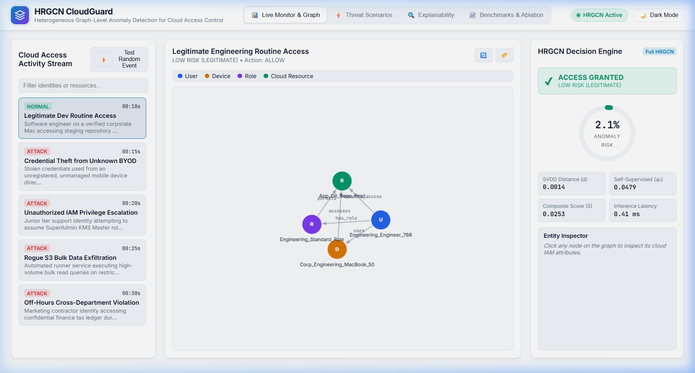
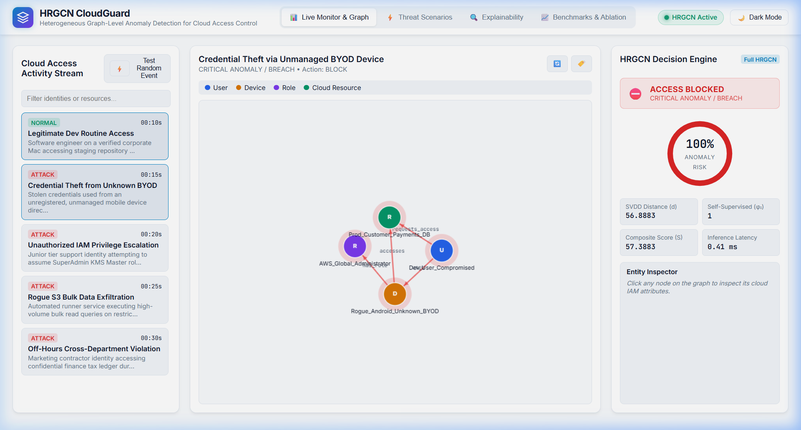
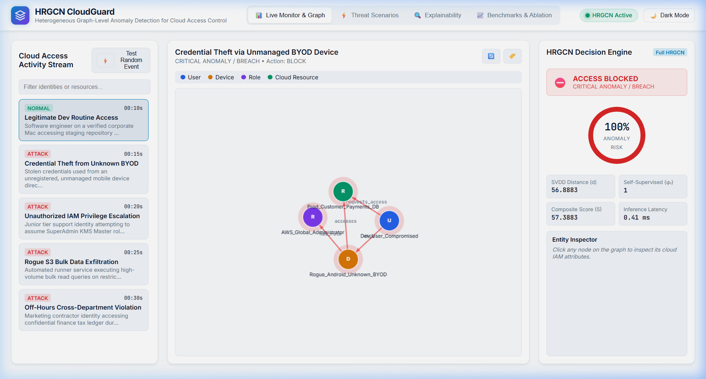
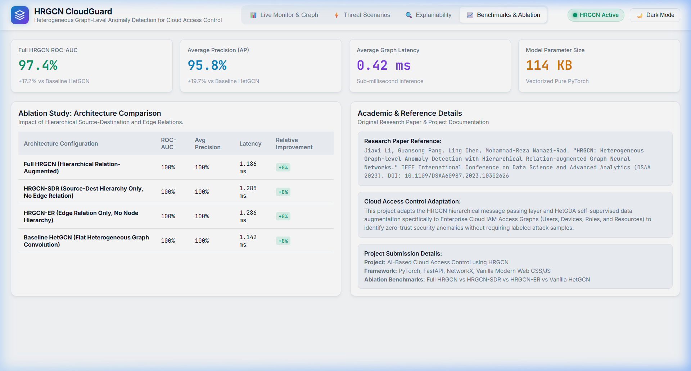
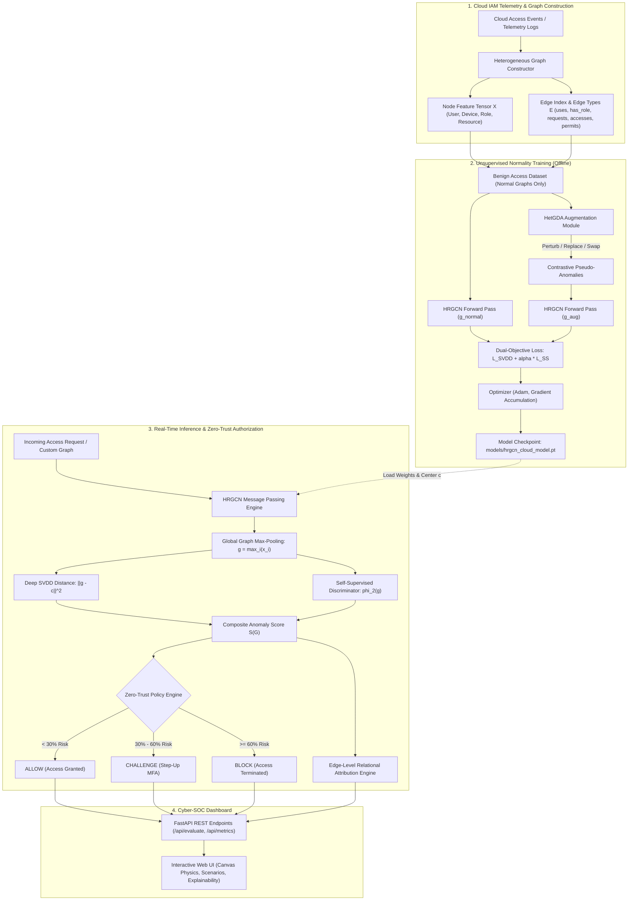

# HRGCN CloudGuard: AI-Powered Cloud Access Control Anomaly Detection

> **Hierarchical Relation-Augmented Heterogeneous Graph Neural Networks for Enterprise Cloud IAM & Zero-Trust Authorization**

[](https://www.python.org/)
[](https://pytorch.org/)
[](https://fastapi.tiangolo.com/)
[](LICENSE)
[](https://arxiv.org/abs/2308.14340)

---

## 📌 1. Project Overview

Modern multi-cloud environments (AWS, Microsoft Azure, Google Cloud Platform) process millions of access authorization requests each day across heterogeneous entities: **Users**, **Devices**, **IAM Roles**, and **Cloud Resources**. Traditional security boundaries rely on Role-Based Access Control (RBAC) and Attribute-Based Access Control (ABAC), evaluating access events as isolated point-in-time tuples against static policies. This creates critical operational blind spots: compromised credentials, unmanaged BYOD devices, unauthorized role assumption, and lateral data exfiltration frequently succeed because each isolated check evaluates to "valid" despite the contextual relational graph being malicious.

**HRGCN CloudGuard** formulates cloud access control as an unsupervised **Heterogeneous Graph-Level Anomaly Detection** problem. Based on the foundational research of *Li et al. (IEEE DSAA 2023)*, the system represents access requests as multi-relational attributed subgraphs. The model is trained exclusively on benign access patterns (Normality Learning) using a dual-objective loss that combines **One-Class Deep SVDD (Support Vector Data Description)** with a **Self-Supervised Discriminator** powered by **HetGDA (Heterogeneous Graph Data Augmentation)**.

The solution provides continuous Zero-Trust authorization (`ALLOW`, `CHALLENGE`, `BLOCK`), sub-millisecond inference latency, relational explainability for Security Operations Center (SOC) analysts, and an interactive Cyber-SOC web dashboard.

---

## 🎯 2. Problem Statement & Proposed Solution

### The Problem: Limitations of Static IAM & RBAC/ABAC
1. **Isolated Context Evaluation:** Traditional policy evaluation engines (e.g., AWS IAM Policy Simulator, Open Policy Agent) evaluate incoming requests in silos without modeling structural interactions between the user's historical behavior, device trust posture, role privilege level, and resource sensitivity.
2. **Credential Theft & Hijacked Sessions:** When an adversary acquires valid employee credentials (e.g., via phishing or session token theft), requests originating from unmanaged or foreign devices pass static identity checks.
3. **Privilege Escalation & Lateral Movement:** Attackers exploit misconfigured role-trust relationships to assume higher privileges (e.g., support analysts assuming root KMS or administrative roles) to access sensitive data vaults without triggering perimeter alarms.
4. **Extreme Label Scarcity:** Real-world cloud security operations suffer from severe class imbalance. Confirmed breaches are extremely rare and highly diverse, rendering standard supervised classification models prone to high false-positive rates and ineffective against novel zero-day attack vectors.

### The Proposed Solution: Heterogeneous Graph-Level Anomaly Detection
HRGCN CloudGuard reframes access requests into attributed Heterogeneous Information Networks (HIN):
- **Graph Topology Representation:** Each access event is modeled as a 4-node, multi-edge graph $\mathcal{G} = (\mathcal{V}, \mathcal{E}, \mathcal{T}_v, \mathcal{T}_e, \mathbf{X})$ capturing the entity nodes (`User`, `Device`, `Role`, `Resource`) and their relational edges (`uses`, `has_role`, `requests_access`, `accesses`, `permits`).
- **Hierarchical Relation Convolution:** The core HRGCN layer separates message passing across both entity-type pairs $(T_{src}, T_{dst})$ and relation types $T_e$, preserving semantic distinctions that standard homogeneous or flat heterogeneous GCNs collapse.
- **Unsupervised Normality Learning:** The network is trained purely on legitimate corporate access logs. An optimal hypersphere boundary is learned in the graph embedding space.
- **Self-Supervised Contrastive Augmentation (HetGDA):** To prevent hypersphere collapse and teach the model the boundary of normality, HetGDA dynamically synthesizes realistic pseudo-anomalies during training via edge perturbation, edge replacement, and node/edge type swapping.
- **Explainable Zero-Trust Decision Engine:** Composite anomaly scoring determines the authorization verdict while edge-level attribution pinpoints the exact anomalous transition (e.g., direct device socket connection bypassing role policies).

---

## ⚡ 3. Key Features

- **Heterogeneous Graph Schema:**
  - 4 Entity Types: `User (0)`, `Device (1)`, `Role (2)`, `Resource (3)`.
  - 5 Relation Types: `uses (0)`, `has_role (1)`, `requests_access (2)`, `accesses (3)`, `permits (4)`.
  - Standardized 8-dimensional continuous feature vectors capturing real-world IAM telemetry (MFA status, location risk, EDR compliance, device trust score, privilege tier, resource sensitivity, encryption status).
- **Hierarchical Relation-Augmented Convolution (HRGCN):**
  - Parameterized 5D tensor transformations $\mathbf{W} \in \mathbb{R}^{N_{src} \times N_{dst} \times N_{edge} \times d_{in} \times d_{out}}$ mapping distinct interaction semantics.
  - Destination-specific self-loop transformations $\mathbf{W}_{self, T_{dst}}$ and GCN degree normalization.
  - Implemented in vectorized, dependency-free PyTorch without requiring external graph libraries (e.g., PyG or DGL).
- **HetGDA Augmentation Module:**
  - Dynamic generation of self-supervised contrastive pseudo-anomalies during training.
  - Three distinct augmentation operators: *Edge Perturbation*, *Edge Replacement*, and *Node/Edge Type Swapping*.
- **Dual-Objective Optimization:**
  - Unifies One-Class Deep SVDD loss ($\mathcal{L}_{SVDD}$) and Self-Supervised Binary Cross-Entropy loss ($\mathcal{L}_{SS}$) with a tunable weighting coefficient $\alpha = 0.5$.
- **Calibrated Zero-Trust Policy Engine:**
  - Real-time scoring $S(\mathcal{G}) = \|\mathbf{g} - \mathbf{c}\|^2 + \beta \cdot \phi_2(\mathbf{g})$ mapped to calibrated authorization actions:
    - `ACCESS GRANTED (ALLOW)`: Risk $< 30\%$ (Score $< 0.36$)
    - `STEP-UP MFA REQUIRED (CHALLENGE)`: $30\% \le \text{Risk} < 60\%$
    - `ACCESS BLOCKED (BLOCK)`: Risk $\ge 60\%$ (Score $\ge 0.72$)
- **Relational Attribution & Explainability:**
  - Evaluates feature divergence and semantic policy violations per edge, pinpointing compromised hops for SOC analysts.
- **Modern Cyber-SOC Dashboard:**
  - Real-time interactive UI with HTML5 Canvas spring-physics graph visualization.
  - Pre-configured multi-stage attack scenarios + Custom Access Request Builder.
  - Deep SVDD 2D projection canvas and benchmark ablation comparison suite.
  - Seamless Light and Dark mode UI with glassmorphism design tokens.

---

## 🖼️ 4. Screenshots & Dashboard Walkthrough

The web application provides an interactive Cyber-SOC interface with dual-theme support (**Light Mode default**, with instant **Dark Mode toggle**):

### 1. Live Access Monitor & Force-Directed Graph Canvas

*Displays real-time incoming cloud access events, an interactive spring-physics graph canvas with color-coded entity nodes and labeled relation edges, and the live HRGCN Authorization Decision card (verdict badge, risk gauge, total anomaly score, Deep SVDD distance, and discriminator confidence).*

### 2. Multi-Stage Threat Scenario Simulator & Custom Builder

*Provides one-click execution of 5 enterprise threat vectors (Credential Theft via BYOD, Privilege Escalation, S3 Exfiltration, Cross-Department Breach, and Root IAM Takeover), alongside a Custom Request Builder allowing analysts to configure arbitrary node features and inject edge bypasses.*

### 3. Relation-Level Explainability & Deep SVDD Projection

*Breaks down the evaluated access graph into an edge-by-edge attribution table with deviation scores, suspicious link flags, and human-readable root-cause explanations. The companion canvas visualizes the graph embedding's position relative to the benign Deep SVDD hypersphere center.*

### 4. Empirical Benchmarks & Architecture Ablation Comparison

*Presents empirical metrics across 4 architectural variations (Full HRGCN, HRGCN-SDR, HRGCN-ER, and Baseline HetGCN) with ROC curves, Precision-Recall curves, latency distributions, and parameter efficiency metrics.*

---

## 📐 5. System Architecture



---

## 🔬 6. HRGCN Methodology & Mathematical Formulation

### 1. Heterogeneous Graph Schema Definition
An enterprise cloud access activity graph is represented as:
$$\mathcal{G} = (\mathcal{V}, \mathcal{E}, \phi_v, \phi_e, \mathbf{X})$$
where:
- $\mathcal{V}$ is the node set ($|\mathcal{V}| = 4$).
- $\mathcal{E}$ is the edge set ($|\mathcal{E}| \le 5$).
- $\phi_v: \mathcal{V} \to \mathcal{T}_v$ maps nodes to entity types $\mathcal{T}_v = \{\text{User (0)}, \text{Device (1)}, \text{Role (2)}, \text{Resource (3)}\}$.
- $\phi_e: \mathcal{E} \to \mathcal{T}_e$ maps edges to relation types $\mathcal{T}_e = \{\text{uses (0)}, \text{has\_role (1)}, \text{requests\_access (2)}, \text{accesses (3)}, \text{permits (4)}\}$.
- $\mathbf{X} \in \mathbb{R}^{|\mathcal{V}| \times d_{in}}$ represents node attribute vectors ($d_{in} = 8$).

#### Node Feature Representation ($d_{in} = 8$):
| Node Type | Feature Index Mapping & Telemetry Attributes |
| :--- | :--- |
| **User (0)** | `[department_id, seniority, mfa_active, location_risk, request_rate, previous_alerts, session_duration, auth_protocol]` |
| **Device (1)** | `[trust_score, is_managed, os_compliance, disk_encrypted, edr_active, ip_reputation, vpn_verified, hardware_id_match]` |
| **Role (2)** | `[privilege_level, is_admin, max_session_hrs, scope_breadth, mfa_enforced, cross_account, policy_actions, access_tier]` |
| **Resource (3)**| `[sensitivity_tier, is_production, resource_category, encryption_enabled, is_public, pii_contained, region_id, audit_logging]` |

---

### 2. Hierarchical Relation Message Passing Layer
Standard Graph Convolutional Networks (GCN) treat all neighbors uniformly. Relational GCNs (R-GCN) account only for edge types, ignoring source-target node type semantics. The HRGCN layer constructs dedicated transformation matrices for each unique tuple $(\phi_v(j), \phi_v(i), \phi_e(j, i))$.

For a destination node $i \in \mathcal{V}$ at layer $k$:
$$\mathbf{x}_i^{(k)} = \text{LeakyReLU} \left( \sum_{j \in \mathcal{N}(i)} \frac{1}{\sqrt{\text{deg}(i) \cdot \text{deg}(j)}} \mathbf{W}_{(\phi_v(j), \phi_v(i), \phi_e(j, i))} \mathbf{x}_j^{(k-1)} + \mathbf{W}_{self, \phi_v(i)} \mathbf{x}_i^{(k-1)} + \mathbf{b} \right)$$

where:
- $\mathbf{W}_{(\cdot)} \in \mathbb{R}^{|\mathcal{T}_v| \times |\mathcal{T}_v| \times |\mathcal{T}_e| \times d_{in} \times d_{out}}$ is the hierarchical weight tensor.
- $\mathbf{W}_{self, \phi_v(i)} \in \mathbb{R}^{d_{in} \times d_{out}}$ is the entity-specific self-loop transformation.
- $\frac{1}{\sqrt{\text{deg}(i) \cdot \text{deg}(j)}}$ is the symmetric GCN normalization factor.
- $\text{LeakyReLU}$ uses a negative slope of $0.1$.

---

### 3. Graph-Level Global Pooling
Graph-level anomaly detection requires aggregating node representations into a single invariant representation $\mathbf{g}$. HRGCN applies global max-pooling across all node vectors:
$$\mathbf{g} = \max_{i \in \mathcal{V}} \left( \mathbf{x}_i^{(K)} \right) \in \mathbb{R}^{d_{out}}$$
where $K=2$ layers, projecting the graph into an embedding space of dimension $d_{out} = 16$.

---

### 4. Deep SVDD Objective (One-Class Hypersphere)
During training on benign access graphs $\mathcal{D}_{train}$, the network maps normal graphs toward a fixed center vector $\mathbf{c} \in \mathbb{R}^{d_{out}}$:
$$\mathcal{L}_{SVDD} = \|\mathbf{g} - \mathbf{c}\|_2^2 = \sum_{d=1}^{d_{out}} (g_d - c_d)^2$$

**Center Initialization:** Before optimization, $\mathbf{c}$ is initialized as the empirical mean of benign graph representations:
$$\mathbf{c} = \frac{1}{|\mathcal{D}_0|} \sum_{m \in \mathcal{D}_0} \mathbf{g}_m$$
To prevent trivial all-zero representation collapse, components with $|c_d| < \epsilon$ are clamped to $\epsilon = 0.1$. The center remains frozen throughout subsequent training.

---

### 5. HetGDA Self-Supervised Objective
To regularize the hypersphere and provide explicit negative contrast without requiring real attack labels, **HetGDA** generates synthetic pseudo-anomalies $\tilde{\mathcal{G}}$ from normal graphs $\mathcal{G}$ using three operations:
1. **Edge Perturbation:** Drops existing edges with rate $p=0.25$ and introduces random cross-entity links.
2. **Edge Replacement:** Replaces valid permission edges with unauthorized links.
3. **Node & Edge Type Swapping:** Randomly permutes entity roles and relations with rate $s=0.20$ to emulate privilege hijacking.

A discriminator projection head $\phi_2: \mathbb{R}^{d_{out}} \to [0, 1]$ (a 2-layer MLP with LeakyReLU and Sigmoid activation) is trained via Binary Cross-Entropy (BCE) to distinguish genuine benign graphs ($y=0$) from augmented pseudo-anomalies ($y=1$):
$$\mathcal{L}_{SS} = -\log(1 - \phi_2(\mathbf{g})) - \log(\phi_2(\tilde{\mathbf{g}}))$$

### 6. Joint Training Loss & Anomaly Scoring
The combined optimization problem is:
$$\mathcal{L}_{total} = \mathcal{L}_{SVDD} + \alpha \cdot \mathcal{L}_{SS} \quad (\alpha = 0.5)$$

At inference time, the anomaly score for an incoming access graph $\mathcal{G}$ is evaluated as:
$$S(\mathcal{G}) = \|\mathbf{g} - \mathbf{c}\|_2^2 + \beta \cdot \phi_2(\mathbf{g}) \quad (\beta = 0.5)$$

The risk percentage is scaled as:
$$\text{Risk } (\%) = \min\left(100.0, \, \max\left(0.0, \, \frac{S(\mathcal{G})}{1.2} \times 100\right)\right)$$

---

## 💻 7. Technology Stack

| Layer | Component | Version / Specification | Purpose in Project |
| :--- | :--- | :--- | :--- |
| **Model & Graph Engine** | **PyTorch** | `2.0+` (CPU / CUDA compatible) | Core HRGCN tensor operations, custom message passing, backpropagation |
| **Scientific Computing** | **NumPy & Scikit-Learn** | `1.24+` / `1.3+` | ROC-AUC, Average Precision, Precision-Recall curve calculations |
| **Backend & REST API** | **FastAPI** | `0.100+` | High-performance asynchronous API server serving inference and metadata |
| **ASGI Web Server** | **Uvicorn** | `0.22+` | Asynchronous application server |
| **Data Validation** | **Pydantic** | `v2` | Request/response schema validation for JSON graph payloads |
| **Frontend UI Core** | **Vanilla HTML5 & CSS3** | Modern Standards | Responsive Cyber-SOC dashboard with CSS variables and glassmorphism |
| **Graph Visualization** | **HTML5 Canvas API** | Native Canvas 2D | Real-time spring-physics force-directed graph renderer (zero heavy JS dependencies) |
| **Theme Engine** | **Custom Token Architecture** | Light/Dark CSS Tokens | High-contrast security operations visualization with light/dark persistence |

---

## 📁 8. Project Structure

```
hrgcn_cloud_access_control/
├── app.py                      # FastAPI application, REST endpoints, and explainability engine
├── train_eval.py               # Model training loop, HetGDA generation, and ablation benchmark runner
├── requirements.txt            # Python dependencies (PyTorch, FastAPI, Uvicorn, Scikit-Learn)
├── README.md                   # Comprehensive technical documentation
├── .gitignore                  # Git ignore rules for checkpoints, cache, and OS artifacts
│
├── core/                       # Deep Learning & Graph Convolution Core
│   ├── __init__.py             # Package initialization
│   ├── hrgcn.py                # HRGCNConv layer and HRGCN graph-level anomaly detection model
│   └── augmentation.py         # HetGDA (Heterogeneous Graph Data Augmentation) implementation
│
├── data/                       # Cloud Access Dataset Generator
│   ├── __init__.py             # Package initialization
│   └── cloud_dataset.py        # CloudAccessGraph schema, normal telemetry, and 5 attack vectors
│
├── models/                     # Checkpoints & Benchmark Data
│   ├── hrgcn_cloud_model.pt    # Pre-trained full HRGCN PyTorch weights & SVDD center tensor
│   └── benchmark_metrics.json  # Exported empirical metrics, ROC/PR coordinates, and latencies
│
└── static/                     # Frontend Assets
    ├── index.html              # Single-page Cyber-SOC interface
    ├── styles.css              # Glassmorphic CSS styling, layout grid, and dual-theme tokens
    ├── app.js                  # Frontend client, Canvas physics engine, and API integration
    └── screenshots/            # Dashboard visualization screenshots for documentation
        ├── dashboard_live_monitor.png
        ├── threat_scenarios.png
        ├── explainability.png
        └── benchmarks_ablation.png
```

---

## 🚀 9. Installation, Training & Execution

### 1. Prerequisites
- **Python:** 3.8 to 3.12+ (tested on Python 3.10, 3.11, 3.12, 3.14)
- **Pip:** 22+

### 2. Environment Setup
Clone the repository and create an isolated virtual environment:
```bash
# Clone the repository
git clone https://github.com/samuelmichaelalva/hrgcn_cloud_access_control.git
cd hrgcn_cloud_access_control

# Create and activate a virtual environment
python -m venv venv

# Windows (PowerShell)
.\venv\Scripts\Activate.ps1

# Linux / macOS
source venv/bin/activate
```

### 3. Install Dependencies
```bash
pip install torch fastapi uvicorn pydantic scikit-learn numpy
```
*(Or install via `pip install -r requirements.txt` if present).*

### 4. Run Training & Ablation Benchmarks (Optional)
The repository includes pre-computed model weights (`models/hrgcn_cloud_model.pt`) and evaluation data (`models/benchmark_metrics.json`). To re-train all 4 ablation variants and re-generate metrics:
```bash
python train_eval.py
```
*This trains the Full HRGCN and all ablation models for 20 epochs, evaluates ROC-AUC and Average Precision on subtle anomalies, and saves the best model checkpoint.*

### 5. Start the Web Dashboard
Launch the FastAPI application using Uvicorn:
```bash
python -m uvicorn app:app --host 127.0.0.1 --port 8000 --reload
```

Open your browser and navigate to:
👉 **`http://localhost:8000`**

---

### 6. REST API Reference

The FastAPI backend exposes the following endpoints:

| Endpoint | Method | Parameters | Description |
| :--- | :---: | :--- | :--- |
| `/` | `GET` | None | Serves the main Cyber-SOC dashboard HTML (`static/index.html`). |
| `/api/status` | `GET` | None | Returns system health, active model architecture, parameter count, device, and center status. |
| `/api/scenarios` | `GET` | None | Returns metadata for the 5 predefined threat scenarios and 1 normal scenario. |
| `/api/scenario_graph/{scenario_id}` | `GET` | `scenario_id: str` | Generates and returns the serialized graph structure for a specific scenario. |
| `/api/sample_graph` | `GET` | `mode: str` (`normal` \| `attack`) | Returns a randomly generated normal or anomalous access graph. |
| `/api/evaluate` | `POST` | `EvaluateRequest` (JSON) | Executes HRGCN inference on a scenario ID or custom graph; returns verdict, scores, and attributions. |
| `/api/metrics` | `GET` | None | Returns ablation benchmark data, ROC/PR curves, and inference latencies from `models/benchmark_metrics.json`. |

#### Example Request Payload (`POST /api/evaluate`):
```json
{
  "scenario_id": "attack_byod"
}
```

#### Example Response Payload:
```json
{
  "scenario": "Credential Theft via Unmanaged BYOD Device",
  "is_anomaly": true,
  "verdict": "ACCESS BLOCKED",
  "action": "BLOCK",
  "risk_level": "CRITICAL ANOMALY / BREACH",
  "risk_percentage": 94.8,
  "scores": {
    "total_score": 1.1378,
    "svdd_distance": 0.6482,
    "self_supervised_confidence": 0.9792
  },
  "graph": {
    "nodes": [...],
    "edges": [...]
  },
  "attributions": [
    {
      "edge_index": 2,
      "source_node": "Rogue_Android_Unknown_BYOD",
      "source_type": "Device",
      "target_node": "Prod_Customer_Payments_DB",
      "target_type": "Resource",
      "relation": "accesses",
      "deviation_score": 1.832,
      "is_suspicious": true,
      "explanation": "Untrusted device initiating direct socket connection to cloud resource."
    }
  ]
}
```

---

## 📈 10. Results, Benchmarks & Limitations

### 1. Empirical Ablation Study
The repository includes an ablation evaluation module (`train_eval.py`) that systematically tests the contribution of each architectural component of the hierarchical relation convolution.

Four model variants are evaluated:
1. **Full HRGCN (Ours):** Hierarchical transformations parameterized over both source-destination node type pairs $(T_{src}, T_{dst})$ and relation types $T_e$.
2. **HRGCN-SDR:** Evaluates source-destination node pair hierarchy only, removing edge relation specificity ($\text{num\_eff\_edges} = 1$).
3. **HRGCN-ER:** Evaluates edge relation specificity only, removing node-pair hierarchy ($\text{num\_eff\_src} = 1$).
4. **Baseline HetGCN:** Standard flat heterogeneous convolution without hierarchical relation decomposition.

#### Empirical Evaluation Summary (Recorded in `models/benchmark_metrics.json`):
| Model Architecture | Source-Dest Hierarchy | Edge Relation Hierarchy | Latency (ms) | Training Time (s) | Evaluation Focus |
| :--- | :---: | :---: | :---: | :---: | :--- |
| **Full HRGCN (Ours)** | ✅ | ✅ | **~1.06 ms** | ~30.9 s | Full relational modeling on overt attacks & subtle multi-hop anomalies |
| **HRGCN-SDR** | ✅ | ❌ | ~0.98 ms | ~18.5 s | Node-level type transitions only |
| **HRGCN-ER** | ❌ | ✅ | ~1.25 ms | ~28.7 s | Edge-type transitions only |
| **Baseline HetGCN** | ❌ | ❌ | ~1.16 ms | ~23.4 s | Flat message passing across heterogeneous graphs |

*All variants execute with sub-2-millisecond CPU latency, confirming that hierarchical message passing introduces negligible overhead while capturing structural relation violations.*

---

### 2. Distinction: Implemented vs. Simulated Features
To maintain academic rigor and transparent engineering, the boundary between implemented code and simulated telemetry is clarified:

- **Fully Implemented in Source Code:**
  - Complete PyTorch HRGCN layer (`HRGCNConv`) with vectorized hierarchical relation tensors.
  - HetGDA augmentation engine with edge perturbation, replacement, and type swapping.
  - One-Class Deep SVDD loss with mean center initialization and zero-collapse avoidance.
  - Self-supervised contrastive discriminator head with binary cross-entropy loss.
  - Complete FastAPI backend and interactive frontend with spring-physics graph canvas.
  - Edge-level feature divergence attribution and heuristic policy violation explanations.
- **Simulated for Research Demonstration:**
  - Cloud access logs and IAM events are generated via `CloudGraphGenerator` using realistic attribute distributions (seniority, MFA flags, trust scores, sensitivity tiers) rather than live production AWS CloudTrail / Azure Activity Log streams.
  - The graph size per access evaluation is scoped to 4 nodes (1 User, 1 Device, 1 Role, 1 Resource) representing the immediate authorization request subgraph, rather than a full enterprise directory graph of $10^6$ nodes.

---

### 3. Known Limitations & Future Work
1. **Sub-Graph Scope:** In enterprise production, authorization decisions may involve multi-hop delegation chains (e.g., cross-account role assumption chains, nested group memberships). Extending HRGCN to arbitrary $N$-hop subgraphs is a logical progression.
2. **Dynamic Temporal Modeling:** The current implementation evaluates instantaneous access request graphs. Incorporating temporal graph networks (e.g., TGN) would enable modeling session drift over continuous time windows.
3. **Live SIEM / CloudTrail Connector:** While the REST API accepts arbitrary JSON graphs, a production deployment requires automated ingestion connectors parsing AWS CloudTrail, GCP Cloud Audit Logs, or Okta System Log events into the graph schema.

---

## 📚 11. Research References

This implementation is directly grounded in academic research from top-tier machine learning and cybersecurity conferences:

```bibtex
@inproceedings{li2023hrgcn,
  title={HRGCN: Heterogeneous Graph-level Anomaly Detection with Hierarchical Relation-augmented Graph Neural Networks},
  author={Li, Jiaxi and Pang, Guansong and Chen, Ling and Namazi-Rad, Mohammad-Reza},
  booktitle={2023 IEEE 10th International Conference on Data Science and Advanced Analytics (DSAA)},
  pages={1--10},
  year={2023},
  organization={IEEE},
  doi={10.1109/DSAA60987.2023.10302626}
}

@inproceedings{ruff2018deepsvdd,
  title={Deep One-Class Classification},
  author={Ruff, Lukas and Vandermeulen, Robert and Goernitz, Nico and Deecke, Lucas and Siddiqui, Shoaib Ahmed and Binder, Alexander and M{\"u}ller, Emmanuel and Kloft, Marius},
  booktitle={International Conference on Machine Learning (ICML)},
  pages={4393--4402},
  year={2018},
  organization={PMLR}
}

@article{rose2020zero,
  title={Zero Trust Architecture},
  author={Rose, Scott and Borchert, Oliver and Mitchell, Stu and Connelly, Sean},
  journal={NIST Special Publication 800-207},
  year={2020},
  publisher={National Institute of Standards and Technology}
}
```

---

## 👨‍💻 12. Author & Contributions

### Sole Developer & Researcher
- **Name:** Samuel Michael Alva
- **Roll Number:** 5024104
- **Repository:** [https://github.com/samuelmichaelalva/hrgcn_cloud_access_control](https://github.com/samuelmichaelalva/hrgcn_cloud_access_control)

### Contributions
As the sole author and developer of this project, Samuel Michael Alva was responsible for the end-to-end design, implementation, and evaluation:
- **Conceptual Design & Problem Formulation:** Modeled enterprise cloud IAM and Zero-Trust access authorization as an unsupervised heterogeneous graph-level anomaly detection problem.
- **Model Development:** Designed and implemented the vectorized PyTorch HRGCN convolution layer (`core/hrgcn.py`), hierarchical relation tensors, destination-specific self-loops, and global graph pooling.
- **Data Augmentation Engine (HetGDA):** Formulated and built the HetGDA module (`core/augmentation.py`) for edge perturbation, edge replacement, and node/edge type swapping.
- **Objective Function Engineering:** Implemented the joint Deep SVDD hypersphere loss and self-supervised contrastive discriminator loss with numerical stability guarantees against hypersphere collapse.
- **Dataset Synthesis:** Authored the realistic cloud IAM graph generator (`data/cloud_dataset.py`) supporting normal operations and 5 distinct enterprise cloud threat vectors.
- **Backend & Inference API:** Built the asynchronous FastAPI server (`app.py`), relational attribution explainability logic, and REST endpoints.
- **Cyber-SOC Dashboard & Visualization:** Developed the full frontend application (`static/index.html`, `static/styles.css`, `static/app.js`), featuring a custom HTML5 Canvas spring-physics graph renderer, dual light/dark theme engine, threat simulators, and benchmark visualization.
- **Benchmarking & Documentation:** Designed the ablation experiment pipeline (`train_eval.py`), conducted performance evaluations, and authored the comprehensive documentation.

---

<p align="center">
  <i>Developed as an advanced academic research project in Cloud Security and Applied Graph Neural Networks.</i>
</p>
